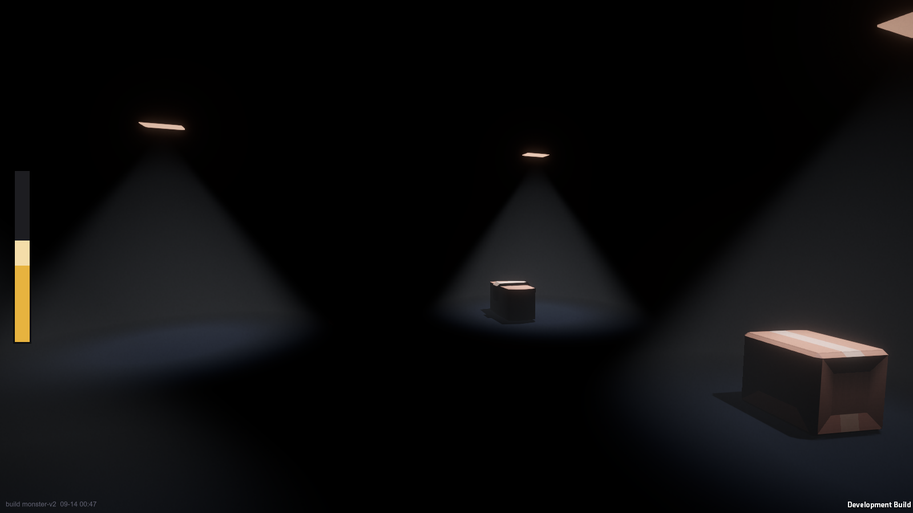
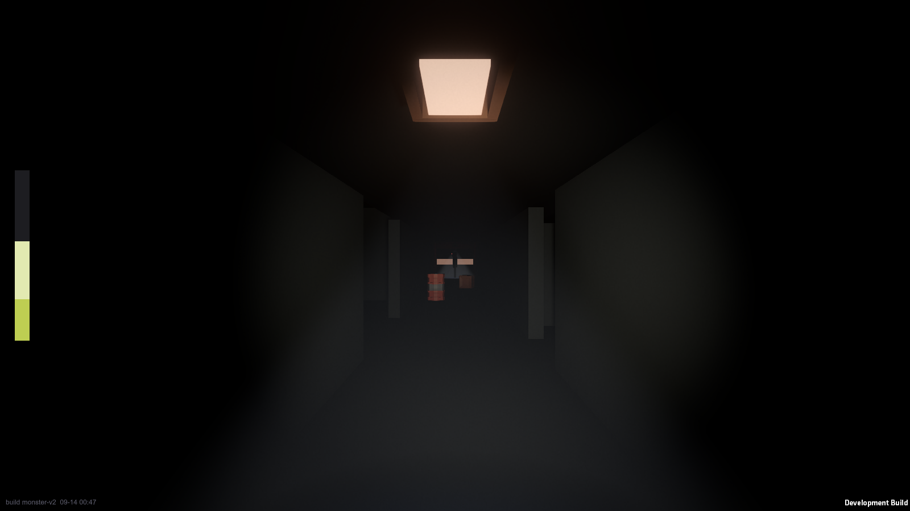
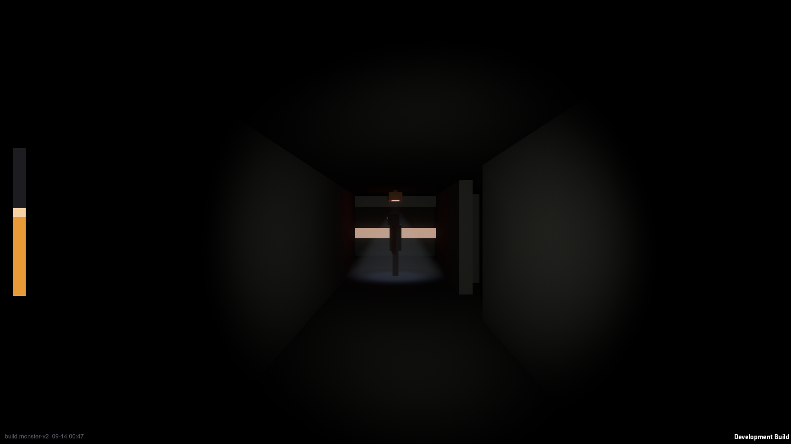
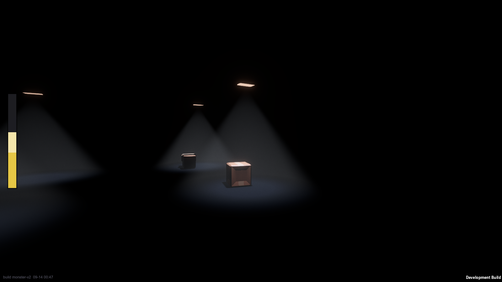
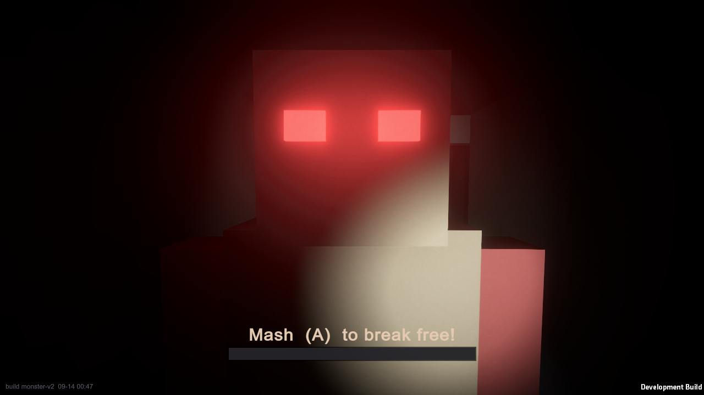

# Silent Fright

**A co-op horror salvage game. Stay quiet, or it finds you.**

*In development for PC (Steam) · Made by Jeremy Marshall · Built with Unity 6*

---

## What it is

Something has sabotaged Christmas present deliveries across the world. You and up to three
friends are a night-shift salvage crew, dropped into a crash site on Christmas Eve to recover
the lost presents and carry them out before the clock runs out. At launch the site is a cargo
plane down in the snow.

You are not the only ones who came for the presents. Something in the wreck hunts by sound.

A run lasts about fifteen to twenty-five minutes: gear up, drop in, search a cramped pitch-dark
wreck by flashlight, grab the loot, and get it to the exit. Big items take two people. Leaving a
friend behind to save the haul is a real choice.

## The two ideas the whole game is built on

**1. Silence is the mechanic.** The game is called *Silent Fright* because the fear lives in the
quiet you are forced to keep. Your footsteps, the crates you knock over, the loot you drop, and
(if you turn a mic on) your own voice all make noise, and noise is what draws the thing that
hunts you. Crouch and move slow and you are safe; get careless and you give yourself away. The
whole game is dangerous with no microphone at all: the mic is only ever an extra way to make
noise, never something you need.

**2. Is it a Halloween game or a Christmas game?** On purpose, it is never quite clear, the way
*The Nightmare Before Christmas* is both at once. Snow, presents, and holiday warmth sit right
next to the dark and the dread, and the game never resolves which one it really is.

The tone is funny-scary, the way the best co-op horror games are: groups of friends whispering,
panicking, laughing, and screaming. When the creature catches you it is a short, sharp scare,
not gore.

## Screens

Everything here is from live in-engine builds. Art is stylized low-poly, flat-shaded, and lit
almost entirely by your flashlight and a few failing work lamps.

| | |
|---|---|
|  |  |
| *A corridor of the wreck. The bar on the left is your own noise meter.* | *A "dead-light" stretch: lit on both sides, pure black in the middle. You can see into it from either end but not through it.* |
|  |  |
| *The way down into the cargo hold.* | *Caught. Placeholder creature model shown; the final creature is in the works.* |

## Where the project is now

The game is being built single-player first and fully playable on a controller, then multiplayer
is layered on top. Solo is treated as a real, complete way to play, not a stripped-down co-op.

**Done and playable today:**

- A first-person salvage crew controller with walking, crouching, running, jumping, and a
  toggleable flashlight, tuned to feel weighty and tense rather than twitchy.
- A hand-built greybox wreck: a fuselage corridor, a cargo hold, a cockpit, narrow branch
  passages, loose physics clutter you can knock over, and the pitch-black "dead-light"
  stretches that are one of the game's signature ideas.
- The noise system that is the heart of the game: everything you do makes a measured amount of
  sound, shown on a personal on-screen meter, and that is what the hunter reacts to.
- A readable creature that hunts by sound, gives clear warnings before it strikes, chases, can
  lose you if you break away and go quiet, and can catch and drag you off if it reaches you,
  with a way to struggle free.
- A start menu, in-game pause, an "observer" mode for watching a round unfold, and a
  streamer-safe audio option.
- A one-button playtest build pipeline that produces a fresh standalone build in seconds.

**Being worked on next:** the full loot-and-extraction loop (carry presents to the exit against a
timer and cash out), a shop and upgrades between runs, procedurally rearranged wreck layouts so
no two runs are the same, and the final art pass on the creature and the wreck.

**After that:** four-player online co-op with proximity voice chat, built host-authoritative so
one player runs the world and everyone else stays in sync.

## How it is being made

This is a solo project run at a deliberately fast, iterative pace: build a small piece, play it,
judge how it feels, adjust, and only then move on. A few things keep that loop honest and quick:

- **Every death has to be fair.** A design rule of the project is that a caught player should
  always be able to name the noise that gave them away. The hunter is built to be readable and
  learnable, never a cheap off-screen kill.
- **Automated verification.** The project includes custom tooling that can run the game with no
  display, drive the camera and the hunter through set scenarios, and capture screenshots and
  diagnostics. That makes it possible to confirm the creature behaves and the scenes render
  correctly on every change, without having to replay by hand each time. The screenshots on this
  page were produced by that same tooling.
- **One shared art palette.** Every model draws its colors from a single flat-color palette
  texture, so props from different sources snap into one consistent low-poly look.
- **Stability first.** Research into thousands of player reviews of the biggest games in this
  genre put bugs and crashes, and unfair random deaths, at the very top of what players hate.
  The project is built to beat the genre on exactly those points: ship stable, and make every
  death traceable to a choice the player made.

## Tech

- **Engine:** Unity 6, Universal Render Pipeline, Windows build target.
- **Art:** stylized low-poly, flat-shaded, palette-driven, dark scenes lit by the flashlight.
- **Input:** full controller support (built and tested on an Xbox controller) alongside
  keyboard and mouse.
- **Planned networking:** peer-hosted, host-authoritative online co-op with proximity voice.
- **Built on Microsoft Azure.** Development, builds, and automated verification all run on an
  Azure virtual machine with GPU, so the whole pipeline lives in the cloud.

## A note on the source

The game's source code and assets are kept in a private repository during development. This page
is a public window into the project's progress; it intentionally does not include the source, the
detailed game mechanics, or the tuning that makes the creature feel the way it does.

---

*Silent Fright &copy; 2026 Jeremy Marshall. Work in progress; everything shown is subject to
change.*
